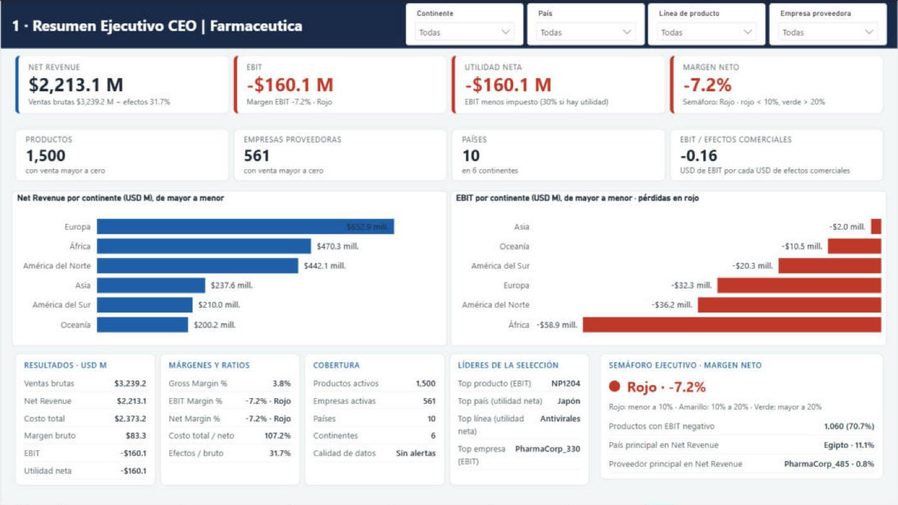
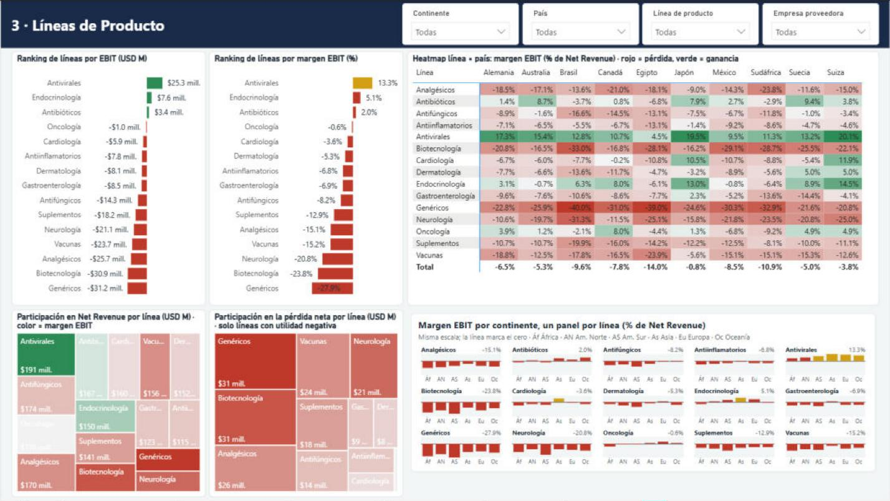
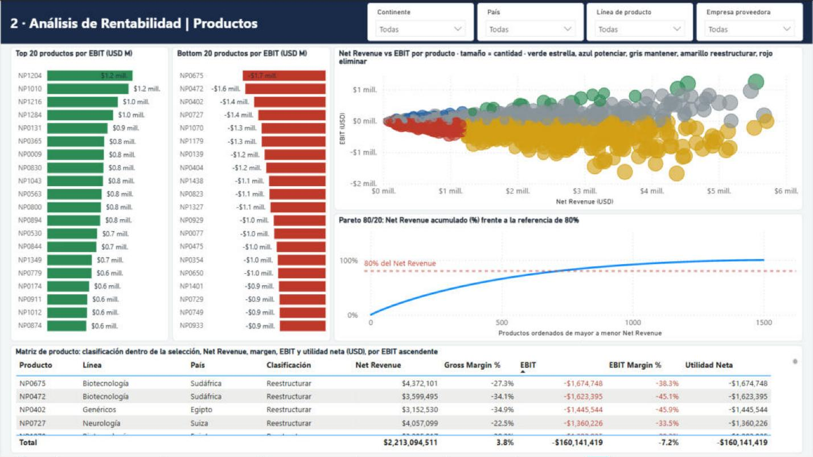
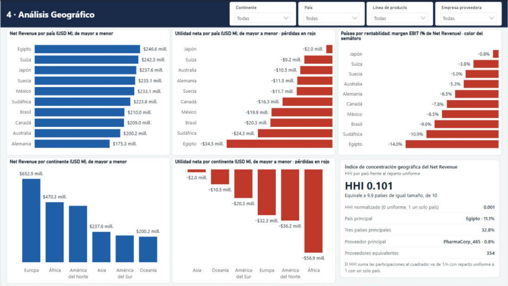
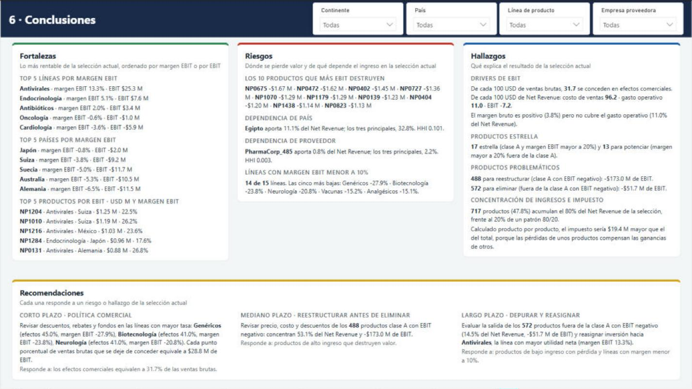
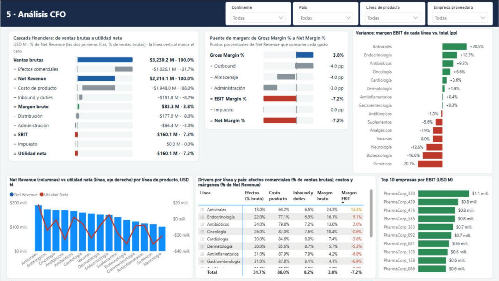
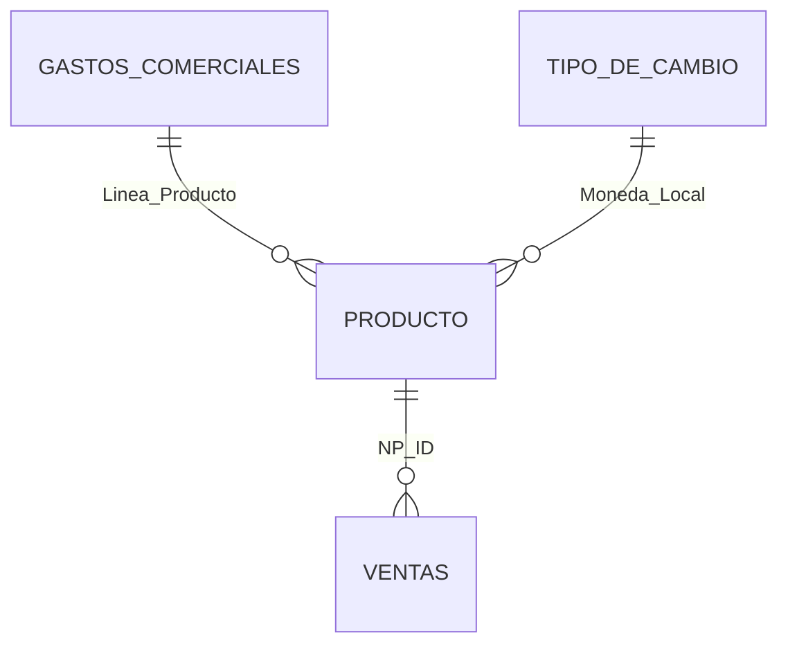

# Análisis financiero de rentabilidad · Power BI

Dashboard financiero para una distribuidora farmacéutica: 1,500 productos (NPs), 561 empresas proveedoras, 15 líneas de producto, 10 países y 6 continentes. Calcula el estado de resultados de cada producto, desde las ventas brutas hasta la utilidad neta, y permite analizarlo por producto, línea, país, continente y empresa.

> **Los datos son sintéticos.** Se generaron para un ejercicio académico; ninguna cifra corresponde a una empresa real. El proyecto nació como una tarea de curso que retomé para reconstruirla con un modelo en estrella, criterios contables explícitos y una narrativa de datos completa.



Reporte completo en PDF: [docs/Análisis_Financiero_PBI.pdf](docs/An%C3%A1lisis_Financiero_PBI.pdf)

## Resultado en una frase

La empresa vende 3,239.2 M USD brutos, pero concede 31.7% en efectos comerciales (descuentos, rebates, fondos de publicidad y marketing). Con el 3.8% de margen bruto que queda no alcanza a cubrir un gasto operativo de 11.0%, y el EBIT termina en **−160.1 M USD (−7.2% del Net Revenue)**. El problema está en la política comercial y en la mezcla de productos, no en la concentración geográfica.

| Estado de resultados | USD M | % |
|---|---:|---:|
| Ventas brutas | 3,239.2 | 100.0% de ventas brutas |
| − Efectos comerciales | −1,026.1 | 31.7% de ventas brutas |
| **= Net Revenue** | **2,213.1** | **100.0%** |
| − Costo de producto | −1,948.0 | 88.0% |
| − Inbound y duties | −181.8 | 8.2% |
| **= Margen bruto** | **83.3** | **3.8%** |
| − Distribución (outbound y almacenaje) | −177.0 | 8.0% |
| − Administración | −66.4 | 3.0% |
| **= EBIT** | **−160.1** | **−7.2%** |
| − Impuesto (30% solo si hay utilidad) | 0.0 | 0.0% |
| **= Utilidad neta** | **−160.1** | **−7.2%** |

Los porcentajes sin etiqueta son sobre Net Revenue.

## Preguntas que responde el modelo

### 1. ¿Qué línea de producto es más rentable globalmente?

**Antivirales**: EBIT de +25.3 M USD y margen EBIT de 13.3%. Es también la línea con menor tasa de efectos comerciales (13.0% de las ventas brutas).

Solo 3 de las 15 líneas tienen EBIT positivo: Antivirales, Endocrinología (+7.6 M, 5.1%) y Antibióticos (+3.4 M, 2.0%). En el otro extremo están Genéricos (−31.2 M, −27.9%), Biotecnología (−30.9 M, −23.8%) y Neurología (−21.1 M, −20.8%), que son a la vez las tres líneas con mayor tasa de efectos comerciales (45%, 41% y 41%).



### 2. ¿Qué productos específicos generan más margen?

| Producto | Línea | País | EBIT (USD M) | Margen EBIT |
|---|---|---|---:|---:|
| NP1204 | Antivirales | Suiza | 1.25 | 22.5% |
| NP1010 | Antivirales | Suiza | 1.19 | 26.2% |
| NP1216 | Antivirales | México | 1.03 | 23.6% |
| NP1284 | Endocrinología | Japón | 0.96 | 17.6% |
| NP0131 | Antivirales | Alemania | 0.88 | 26.8% |

Siete de los diez productos con mayor EBIT son Antivirales y los otros tres son de Endocrinología. El modelo marca 17 productos como "estrella": están entre los que acumulan el 80% del Net Revenue y además tienen margen EBIT mayor a 20%.

### 3. ¿Cuáles presentan pérdidas o bajo rendimiento?

1,060 de los 1,500 productos (70.7%) tienen EBIT negativo. Entre todos pierden 224.7 M USD, frente a los 64.6 M que ganan los 440 productos rentables. 643 productos ya tienen margen bruto negativo: su precio neto no cubre ni el costo de adquisición.

Los cinco que más EBIT destruyen:

| Producto | Línea | País | EBIT (USD M) | Margen EBIT |
|---|---|---|---:|---:|
| NP0675 | Biotecnología | Sudáfrica | −1.67 | −38.3% |
| NP0472 | Biotecnología | Sudáfrica | −1.62 | −45.1% |
| NP0402 | Genéricos | Egipto | −1.45 | −45.9% |
| NP0727 | Neurología | Suiza | −1.36 | −33.5% |
| NP1070 | Biotecnología | Egipto | −1.29 | −39.3% |



### 4. ¿Qué países concentran más productos y mayor rentabilidad?

Por número de productos: Egipto (163), Japón (161), Suiza (158), Suecia (154) y Brasil (153). El reparto es casi uniforme: el índice de concentración HHI por país es 0.101, equivalente a 9.9 países de igual tamaño sobre 10.

Por rentabilidad, ningún país tiene EBIT positivo. Los que menos pierden son Japón (−0.8% de margen EBIT, −2.0 M USD), Suiza (−3.8%) y Suecia (−5.0%). Egipto es el país con más productos y más Net Revenue (246.6 M, 11.1% del total) y también el de peor margen (−14.0%, −34.5 M).



### 5. ¿Cuál es el margen promedio por continente?

| Continente | Net Revenue (USD M) | EBIT (USD M) | Margen EBIT |
|---|---:|---:|---:|
| Asia | 237.6 | −2.0 | −0.8% |
| Europa | 652.9 | −32.3 | −5.0% |
| Oceanía | 200.2 | −10.5 | −5.3% |
| América del Norte | 442.1 | −36.2 | −8.2% |
| América del Sur | 210.0 | −20.3 | −9.6% |
| África | 470.3 | −58.9 | −12.5% |

El margen se calcula como EBIT total entre Net Revenue total de cada continente (promedio ponderado). Un promedio simple de los márgenes de cada producto daría el mismo peso a un producto de 10 mil USD que a uno de 5 millones.

### 6. Si se quisiera mejorar la rentabilidad total, ¿qué productos deberían priorizarse?

1. **Política comercial, corto plazo.** Cada punto porcentual de ventas brutas que se deje de conceder en efectos comerciales equivale a 28.8 M USD de EBIT. Bajar la tasa de 31.7% a alrededor de 26.1% llevaría el EBIT a cero, suponiendo que el volumen no cambia. El primer lugar donde revisar son Genéricos, Biotecnología y Neurología.
2. **Reestructurar antes de eliminar, mediano plazo.** 488 productos de alto ingreso con EBIT negativo concentran 53.1% del Net Revenue y −173.0 M USD de EBIT. Por su tamaño conviene revisar precio, costo y descuentos antes de pensar en retirarlos.
3. **Depurar, largo plazo.** 572 productos de bajo ingreso con EBIT negativo aportan 14.5% del Net Revenue y −51.7 M USD de EBIT. Son los candidatos a salir del portafolio.
4. **Proteger lo que funciona.** Los 17 productos estrella y los 13 con margen alto y bajo ingreso, sobre todo en Antivirales.



## Criterios de cálculo

Las métricas siguen la estructura de un estado de resultados por función. Estas son las normas en las que se apoya cada criterio:

| Concepto | Criterio | Sustento |
|---|---|---|
| Ingreso | Net Revenue = ventas brutas − efectos comerciales. Los descuentos, rebates y fondos concedidos al cliente reducen el ingreso, no son un gasto. | NIIF 15 (contraprestación variable y contraprestación pagadera al cliente) |
| Costo de ventas | Costo de producto + flete de entrada (inbound) + aranceles (duties). Las tasas de inbound y duties se aplican sobre el costo importado, que es la base del valor en aduana, y no sobre el precio de venta. | NIC 2 (costos de adquisición de inventarios) |
| Gastos de operación | Distribución (outbound 4% y almacenaje 4%) y administración (3%), presentados por función y calculados sobre Net Revenue. | NIC 1 (presentación de gastos por función) |
| Impuesto | 30% del EBIT solo cuando es positivo, calculado sobre el total de la selección. Con pérdida no se reconoce beneficio fiscal. | NIC 12, con criterio prudente |
| Moneda | El costo local se convierte a USD multiplicando por el tipo de cambio de la fuente, que expresa el valor en USD de una unidad de moneda local. | NIC 21 |
| Márgenes | Siempre cociente de sumas, nunca promedio de porcentajes. | Práctica de análisis financiero |
| Concentración | Índice Herfindahl-Hirschman, su versión normalizada y el número equivalente (1/HHI). | Medida económica estándar de concentración |
| Pareto y clasificación | Clase A = productos que acumulan el 80% del Net Revenue. Estrella, Potenciar, Mantener, Reestructurar y Eliminar combinan clase A con signo y nivel del margen EBIT. | Criterio de gestión, no norma contable |

Supuestos propios del ejercicio, que no vienen de una norma: la fuente trae un solo periodo y un solo tipo de cambio por moneda; no hay depreciación ni intereses, así que el EBIT coincide con la utilidad antes de impuestos; las bases de cada tasa (costo para inbound y duties, Net Revenue para outbound, almacenaje y administración) son la lectura que hice del enunciado. Todas las tasas y umbrales son medidas parametrizadas en el modelo y pueden cambiarse en un solo lugar.



## Modelo de datos

Esquema en estrella con una tabla de hechos y tres dimensiones, más una tabla de medidas.



| Tabla | Contenido |
|---|---|
| Ventas | Hechos: precio en USD, costo local, tasas de inbound y duties, cantidad vendida |
| Producto | Dimensión: NP, empresa, línea, país, continente y moneda |
| Tipo de Cambio | Un tipo de cambio por moneda local |
| Gastos Comerciales | Tasas de descuento, rebate, fondo de publicidad y marketing por línea |
| Metricas | 106 medidas DAX organizadas en 10 carpetas: parámetros, estado de resultados, márgenes, conteos, rankings, Pareto y concentración, semáforos, comparativos, narrativa y calidad de datos |

La ruta del archivo de origen es un parámetro de Power Query, y el modelo incluye medidas de calidad de datos que avisan si aparece una línea sin tasas, una moneda sin tipo de cambio o un producto con datos inválidos.

Núcleo del estado de resultados en DAX:

```dax
Gross Revenue = SUMX ( Ventas, Ventas[Precio_USD] * Ventas[Cantidad_Vendida] )

Efectos Comerciales =
SUMX (
    Ventas,
    Ventas[Precio_USD] * Ventas[Cantidad_Vendida]
        * RELATED ( 'Gastos Comerciales'[Tasa Comercial] )
)

Net Revenue = [Gross Revenue] - [Efectos Comerciales]

Costo de Ventas = [Costo Producto] + [Inbound Cost] + [Duties Cost]

Margen Bruto = [Net Revenue] - [Costo de Ventas]

EBIT = [Margen Bruto] - [Gasto Operativo]

EBIT Margin % = DIVIDE ( [EBIT], [Net Revenue] )
```

## Páginas del reporte

| Página | Para qué sirve |
|---|---|
| 1 · Resumen ejecutivo | KPIs, resultados por continente y semáforo de margen neto |
| 2 · Análisis de rentabilidad | Top y bottom 20 productos, dispersión Net Revenue vs EBIT, Pareto y matriz de producto |
| 3 · Líneas de producto | Ranking por EBIT y margen, mapa de calor línea × país, participación en ingreso y en pérdida |
| 4 · Análisis geográfico | Net Revenue y utilidad por país y continente, índice de concentración |
| 5 · Análisis CFO | Cascada de ventas brutas a utilidad neta, puente de margen, drivers por línea y país |
| 6 · Conclusiones | Fortalezas, riesgos, hallazgos y recomendaciones, recalculados con los filtros activos |

Todas las páginas comparten cuatro filtros sincronizados: continente, país, línea de producto y empresa proveedora.

## Contenido del repositorio

```
README.md
docs/
├── Análisis_Financiero_PBI.pdf   reporte exportado
└── img/                          capturas de las seis páginas
```

El archivo de Power BI y el Excel de origen no se incluyen en el repositorio.

## Herramientas

Power BI Desktop (formato de proyecto PBIP, modelo en TMDL), Power Query, DAX y el visual HTML Content para las tarjetas y la narrativa.

## Autor

Héctor Calderón
